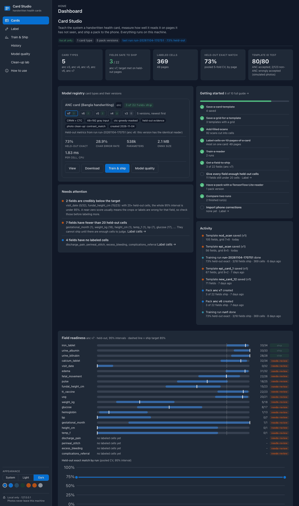
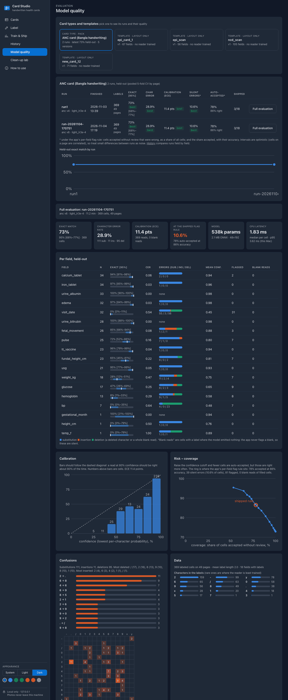
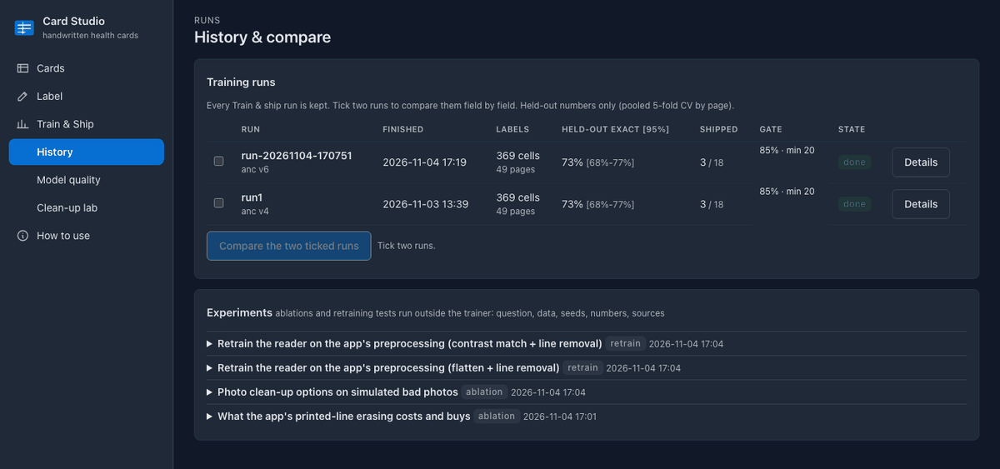
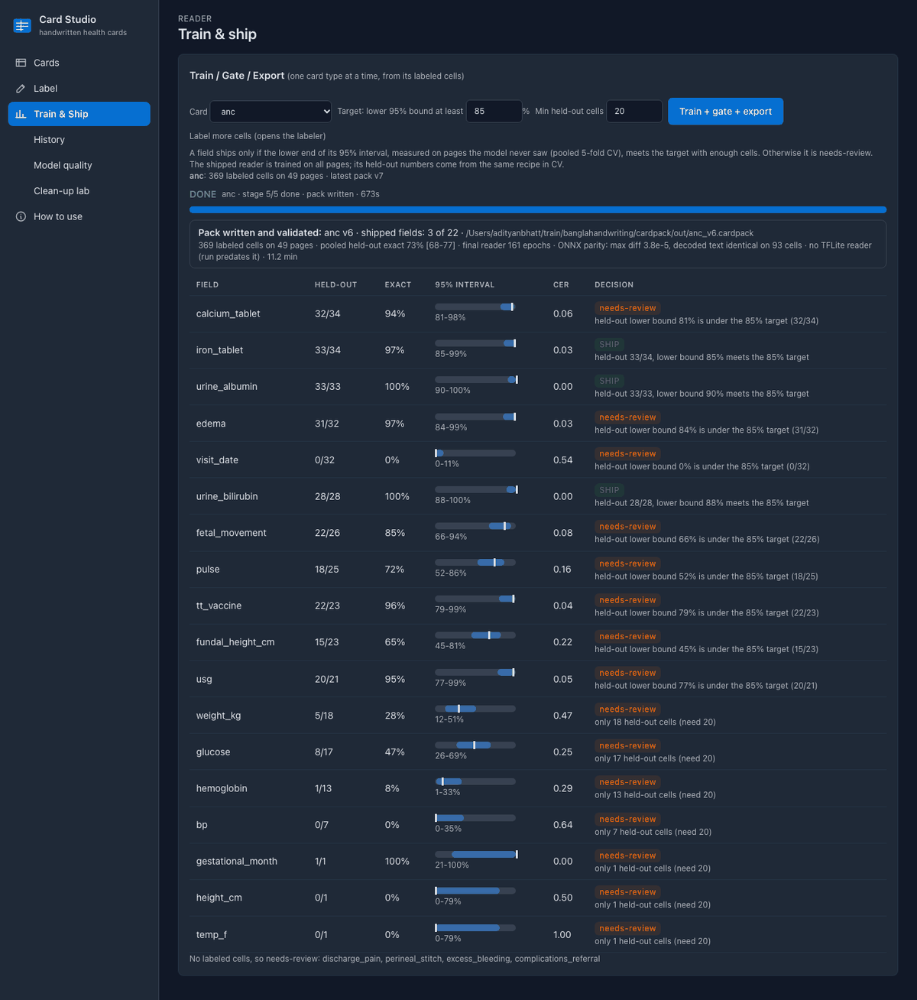
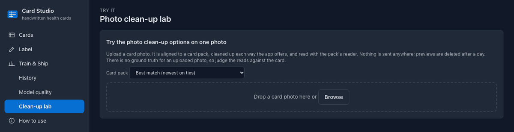
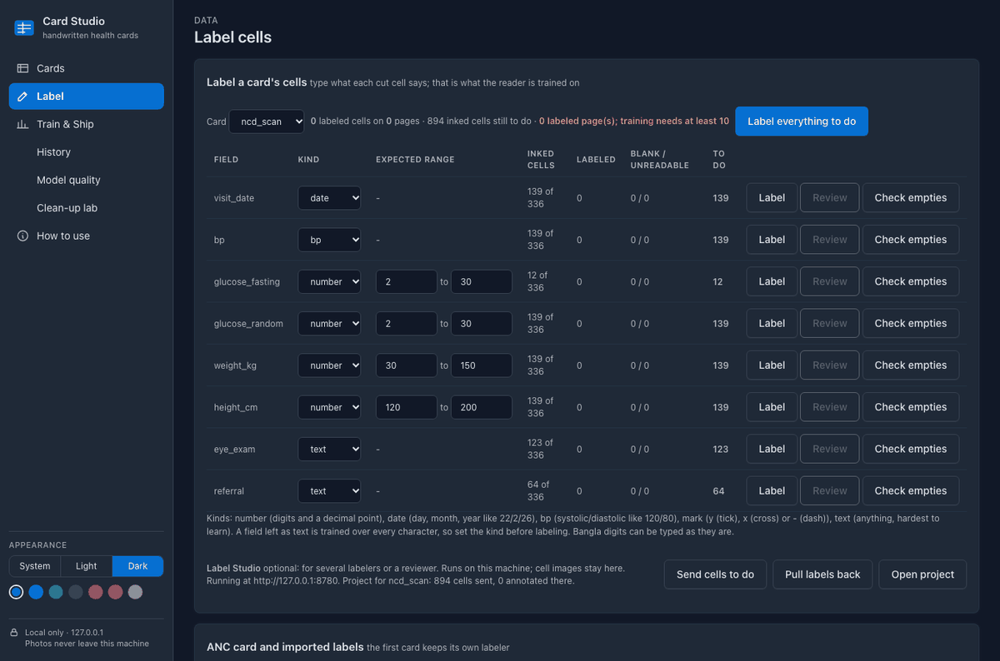

# Card Studio

A local-first platform for reading **handwritten health cards**: teach it a card, measure how well it reads each field on pages it has not seen, and ship the result to a phone as a self-contained **card pack**.

Everything runs on one machine and binds to `127.0.0.1` only. There are no cloud OCR or LLM calls, and photos are never uploaded.

> **Privacy.** This repository contains **code and documentation only**. The system was built on real patient records, which are never committed: no scans, crops, labels, trained weights, packs, notebooks (their saved outputs hold card images), or PDFs. `tools/leakcheck.py` enforces that with an allowlist before every commit, and the `.gitignore` keeps your own data out if you run this on yours. The screenshots below show aggregate metrics only and are captured in a mode that never renders card images.

## Status

_Aggregate numbers from the author's own labeled data, updated 2026-11-11. Held-out = pooled 5-fold cross-validation split by page._

| | |
|---|---|
| Card types / pack versions | 1 / 5 |
| Saved templates | 4 |
| Labeled cells | 369 on 49 pages |
| Training runs / experiment records | 2 / 4 |
| Fields that meet the ship gate | 3 of 22 (anc v7) |
| Held-out exact match, latest run | 73% (95% 68% to 77%), 369 cells |
| Held-out character error rate | 28.9% |
| Calibration error (ECE) | 11.4 points |
| Under the app's flag rule | 78% auto-accepted at 86% accuracy; silent errors 10.6% of cells |


## Screenshots

**Dashboard: model registry, getting started, activity, needs attention, field readiness**



**Model quality: per-field errors, calibration, risk-coverage, confusions, flag-policy tuner, provenance**



**History: training runs, paired comparison, experiment records**



**Train and ship: held-out gate per field**



**Photo clean-up lab (empty state)**



**Label and import corrected labels**




## What is in it

| Piece | What it does |
|---|---|
| **Card Studio** (`studio/`) | A local web app: upload and identify a card, detect and edit its layout, add filled scans (each is matched to its template, straightened and cut into cells), label cells, train and gate a reader, compare runs, inspect model quality, and try photo clean-up options. Stdlib `http.server`, OpenCV, no framework. UI: [Tabler](https://tabler.io) (MIT), vendored, no CDN. |
| **Card pack format** (`cardpack/`) | One zip holding everything a phone needs to recognise and read one card type: template, grid, field rules, reader model (ONNX, and the same weights as TensorFlow Lite), preprocessing. Versioned, hashed, validated. See [`cardpack/CARDPACK.md`](cardpack/CARDPACK.md). |
| **Training recipe** (`work_phaseA/`) | CRNN + CTC reader (about 538k parameters), page-level splits, field-masked decoding, Wilson intervals. |
| **Tools** (`tools/`) | The leak check, screenshot capture, README generator and publish script. |

Studio tabs: **Dashboard** (model registry, getting started, activity, what needs attention), **Label** (set each field's kind, then type what each cut cell says, one cell at a time from the keyboard; optionally send the cells to a local [Label Studio](https://labelstud.io) and pull its labels back; import corrected labels), **Train & Ship** (held-out gate per field), **History** (runs, paired comparison, experiments), **Model quality** (failure browser, calibration, risk-coverage, confusions, flag-policy tuner, provenance), **Clean-up lab** (try each photo clean-up on one photo), **How to use** (these steps, and how the reader works).

## How to use

From a new card to a model on the phone. Start Studio with `python studio/server.py` and open http://127.0.0.1:8770. The same steps are on the **How to use** tab.

1. **Add the card type** (Cards tab). Under **Add a new card type**, drop one clean, flat picture of the card. Use the same kind of capture as the cards you will read later: a scan for scans, a phone photo for phone photos. Turn it the right way up, fix the detected cells, and give a name to the cell that labels each field (the label at the left of a row, or the heading above a column). Approve and save the template.
2. **Save its grid** (Cards tab). In **Layouts**, press **Grid**. Say whether each field is a row (a column per visit, like ANC and EPI cards) or a column (a row per visit, like the NCD card). Skip printed label columns and heading rows until the boxes in the preview sit exactly on the cells people write in, then save.
3. **Add filled cards** (Cards tab). In **Filled scans**, leave the card on Auto-identify and add your scans, photos or a PDF. Each one is matched to its template, straightened and cut into cells. Open **Scans** and press **View grid** on anything marked *check*. A scan that matches no template is refused, not guessed.
4. **Set each field's kind** (Label tab). Pick the card, then choose a kind for every field: number, date, bp, mark or text, and an expected range for numbers. Do this before labeling: the kind decides which characters the reader may produce.
5. **Label the cells** (Label tab). Press **Label** on a field and type what each cell says. Enter saves and moves on, Ctrl+B means nothing is written, Ctrl+U means it cannot be read. Training needs labels on at least 10 pages; more pages and more writers give a better reader. To share the work, send the cells to Label Studio from the strip below the table and pull the labels back.
6. **Train and check** (Train & Ship tab). Choose the card and press **Train + gate + export**. Every labeled cell is read once by a model that never saw its page. A field ships only if the low end of its 95% interval meets the target; the rest stay needs-review.
7. **Take the model** (Cards tab). In **Model registry**, press **View** on the new pack. Download the pack (template, grid, field rules, and the reader as ONNX and TensorFlow Lite), or only **reader.tflite**.
8. **Improve it** (Model quality tab). Look at which fields and which mistakes are worst, label more of those, train again, and compare the two runs in History.

From the command line: `python studio/scans.py add auto FOLDER` adds a large batch of scans, `python studio/labelstudio.py start` runs the optional Label Studio, and `python studio/tflite_export.py add PACK.cardpack` adds a TensorFlow Lite reader to an existing pack.

## How "good" is decided

A field is shipped only if the **lower end of its 95% interval**, measured on pages the model never saw (pooled 5-fold cross-validation, split by page), meets a target with enough cells. Otherwise it stays **needs-review**. Only held-out numbers are called accuracy; numbers on training pages are labelled as such. Intervals are optimistic because cells on a page are correlated.

## Quick start

```sh
pip install numpy opencv-python onnxruntime pillow pypdfium2 jsonschema    # Studio
pip install torch                                              # only for training
python -m venv studio/.venv-tflite && studio/.venv-tflite/bin/pip install tensorflow onnx onnxruntime numpy   # only for the TFLite reader
python studio/server.py                                        # http://127.0.0.1:8770
```

Studio starts empty on a fresh clone: follow How to use above with your own cards. A small synthetic pack for tests lives in `cardpack/synthetic.py`.

```sh
CARDPACK_SYNTHETIC=1 python cardpack/test_cardpack.py          # pack format
python -m unittest discover -s studio/tests                    # Studio backend
python -m unittest discover -s tools                           # leak check
python tools/leakcheck.py .                                    # nothing patient-like in this tree
```

## Layout

```
studio/        web app: server.py, trainer.py, detect.py, cleanup.py, mlstats.py, analysis.py, history.py, experiments.py, ... and tests/
cardpack/      card pack format: CARDPACK.md, schema/, cardpack.py (build, read, validate), synthetic.py
work_phaseA/   training recipe and evaluation scripts (code only)
tools/         leakcheck.py, screenshots.py, update_readme.py, publish.py
docs/          screenshots/ (registered in MANIFEST.json), status.json
```

## Keeping this page current

`python tools/publish.py` regenerates the numbers and screenshots from a running Studio, runs the leak check and the tests, then commits and pushes. Nothing is pushed if the leak check or a test fails.

## Limits

- Evidence comes from a small labeled set; most fields have under 40 held-out cells, so differences of a few points are noise.
- The phone app is not part of this repository. Phone-photo accuracy has not been measured on real labeled phone photos.
- A new card's pack copies the ANC card's matching and photo clean-up settings; they have not been tuned on other cards. The reader reads one line of writing left to right, so cells written on two lines (a date stacked over its year, a blood pressure split by a diagonal) are likely to read badly.
- A grid can run either way: one field per row with a column per visit (`ruled-columns-v1`), or one visit per row with a column per field (`ruled-rows-v1`). Studio cuts, trains and packs both; the phone app only reads the first so far.
- A template should come from the same kind of capture as the scans it will match: a colour phone photo used as the template did not match photocopied scans of the same card.
- License: not chosen yet. Until the maintainers add a `LICENSE` file, all rights are reserved.
